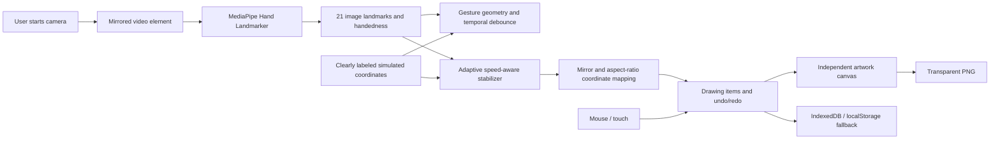

# GestureCanvas AI

A browser-based, local-first drawing studio controlled by hand movement. The application combines webcam hand-landmark tracking with an independent, editable Canvas 2D artwork layer. The included simulated demo and mouse/touch drawing remain usable without a camera.

## Project overview

GestureCanvas explores touch-free creative input for sketching and classroom demonstrations. It turns a camera image into fingertip coordinates, then maps them to a canvas. The project qualifies as an image-processing and computer-vision application because it processes live image frames through Google's pretrained hand detector and landmark estimator, extracts 21 hand keypoints, classifies hand geometry, and transforms image coordinates into a graphics surface. It performs **no facial recognition**.

## Features

- Explicit, user-initiated camera start/stop; local MediaPipe Hand Landmarker, two-hand support, mirrored preview, landmark overlay, handedness and fingertip cursor.
- Camera-free simulated tracking visibly labeled as simulated, plus mouse/touch input.
- Adaptive off/low/medium/high smoothing with speed-sensitive response and jitter filtering.
- Pinch-to-draw; open-palm/fist pause gestures stop strokes immediately; optional hand-proximity pause estimates palm scale in the camera frame with an adjustable limit and hysteresis. Gestures never erase or switch tools.
- Pen, marker, eraser, line, rectangle, ellipse, arrow and text tools; custom/palette colors, brush width and opacity, undo/redo, canvas backgrounds, symmetry and guides.
- Select mode hit-tests visible drawing objects; drag a selected stroke, shape or text to reposition it, then use **Delete selected** to remove that object. Movement and removal can both be undone/redone. Pinch-to-draw still creates an object between pinch and release.
- Optional live camera-feed canvas background for in-camera composition. Select it in **Canvas → Camera feed** while the camera is on. The feed is preview-only and is never recorded, saved into artwork, or included in PNG exports; choose a solid/transparent background for exports.
- On-device artwork library via IndexedDB and a localStorage fallback, reopening, renaming and confirmed deletion; transparent PNG export contains artwork only.
- Keyboard shortcuts and actionable camera/model/storage error messages.

## Technology and architecture

React 19, TypeScript, Vite, HTML Canvas 2D, `@mediapipe/tasks-vision`, IndexedDB, Vitest, React Testing Library and jsdom. No application backend or paid inference endpoint is required.



The vision pipeline is: camera permission requested on button press → video frames → local MediaPipe palm/hand inference → 21 landmarks and handedness → normalized gesture geometry → fingertip stabilization → cover-crop and mirror mapping → separate artwork rendering. MediaPipe returns normalized image landmarks. The app uses index fingertip landmark 8, thumb landmark 4 for pinch geometry, and wrist/finger joints to estimate open palm, fist and index poses. Gestures require temporal stability. Pinching has separate engage/release thresholds.

The drawing engine stores complete drawing items instead of camera screenshots. It uses quadratic interpolation for pen/marker paths, Canvas paths for shapes, `destination-out` for artwork-only erasing and a per-item history for undo/redo. PNG export draws onto a fresh off-screen canvas and never includes video, hand landmarks or page controls.

## Installation and launch

Requirements: Node.js 20+ and npm. From this project directory:

```sh
npm install
npm run dev
```

Vite prints a local URL, normally `http://127.0.0.1:5173`. Camera access requires `localhost` or HTTPS in current browsers. The demo works after dependencies are installed without webcam permission. The launch scripts use Vite's runner config loader because this creation device blocks the default loader's parent-directory access; Vite and TypeScript were validated with these project scripts.

In Windows PowerShell, if the execution policy blocks `npm.ps1`, use `npm.cmd` instead (for example, `npm.cmd run dev`); this avoids changing the system execution policy.

### One-time local model download

The official pretrained `hand_landmarker.task` bundle is a one-time asset at `public/models/hand_landmarker.task`, separate from the JavaScript runtime package. The current working copy now includes Google's official float16 model (7,819,105 bytes, about 7.8 MB), downloaded successfully. The `.task` file is intentionally excluded from Git; fresh clones should fetch it once with an internet-connected terminal:

```sh
npm run model:download
```

This uses Google's current Hand Landmarker float16 model URL. If PowerShell blocks `npm.ps1`, use `npm.cmd run model:download`. If the network blocks the command, download this URL in a browser and save the file at the exact path above:

`https://storage.googleapis.com/mediapipe-models/hand_landmarker/hand_landmarker/float16/latest/hand_landmarker.task`

Then (re)start Vite and press **Start camera**. The application shows a recoverable missing-model message if the file is absent, and the simulated demo remains available either way. The required MediaPipe WebAssembly runtime files are copied from the installed npm package to `public/wasm` during `npm install`. Camera/model initialization still needs a real browser and camera test.

### Vercel deployment

The repository's `vercel.json` builds the app and downloads the ignored model into `public/models` as part of each Vercel build, then publishes `dist`. This avoids committing the 7.8 MB model binary and provides the camera model to the HTTPS deployment. WebAssembly assets are copied during `npm install` by the package's `postinstall` script.

## Build and tests

```sh
npm run typecheck
npm test
npm run build
npm run preview
```

## Controls

- **Start camera** requests permission only after the click. **Stop camera** closes the model, stops media tracks and cancels inference frames.
- **Try demo** displays simulated coordinates, not actual hand tracking. It needs no webcam permission.
- **Start drawing** enables index-finger drawing. Alternatively enable **Pinch to draw**. Mouse or touch works directly on the canvas.
- Shapes: drag from the start point to the end and release. Text: select Text, click/tap to place, then enter its content.
- **Open palm** and **fist** pause gesture drawing when enabled. Neither gesture is destructive.
- Keyboard: `D` toggles drawing, `P` pen, `E` eraser, `M` marker, `Ctrl/⌘+Z` undo, `Ctrl/⌘+Shift+Z` redo, `Ctrl/⌘+S` save, `C` clear with confirmation, `Escape` finishes an active stroke or closes a dialog.
- Select transparent, white, black, grid or custom background. Separate guides and symmetry can be toggled.

## Privacy

Camera startup is opt-in and requests no audio. Frames are processed in this browser and never recorded or uploaded. Artwork is stored in this browser profile. Export is local. Media tracks and model resources are released on stop or page exit. No person is identified and no face detection is used.

## Troubleshooting

- **Permission denied:** allow camera access in browser settings and retry, or use Try demo.
- **No camera / camera busy:** connect a webcam or close the application currently using it.
- **Insecure origin:** use `localhost` or HTTPS; browsers restrict camera APIs on ordinary insecure remote origins.
- **Missing model:** run `npm run model:download`, place the task bundle under `public/models/`, restart Vite and retry. Demo and pointer drawing still work without it.
- **Storage full/blocked:** export a PNG backup and remove older items in the artwork library. Invalid saved records are ignored.
- **PNG export fails:** use a current Chrome/Edge browser and check canvas-size limits.

## Limitations

Gesture classification and hand-proximity estimation use landmark-geometry heuristics; proximity is a relative camera-frame estimate, not calibrated physical distance, and should be calibrated for camera angle, hand pose, framing and lighting. Inference runs synchronously on the browser main thread, so frame cadence depends on the device. This machine could not fetch the model and did not expose a physical-camera test, so real-world ML accuracy and physical camera startup remain unverified. The simulated demo tests application drawing integration only. The gallery is per-browser, not a cloud library.

## References

- [Google MediaPipe Hand Landmarker overview and model bundle](https://developers.google.com/edge/mediapipe/solutions/vision/hand_landmarker)
- [Google MediaPipe Hand Landmarker for Web and JavaScript](https://developers.google.com/edge/mediapipe/solutions/vision/hand_landmarker/web_js)
- [MediaPipe Tasks Vision npm package](https://www.npmjs.com/package/@mediapipe/tasks-vision)
- [React](https://react.dev/)
- [Vite](https://vite.dev/)
- [Vitest](https://vitest.dev/)
